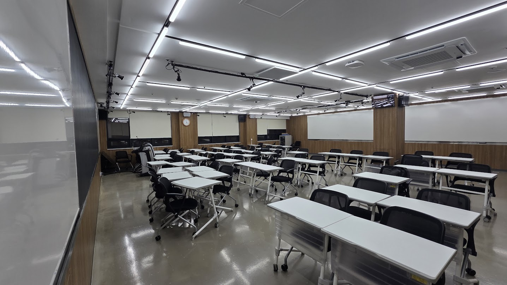
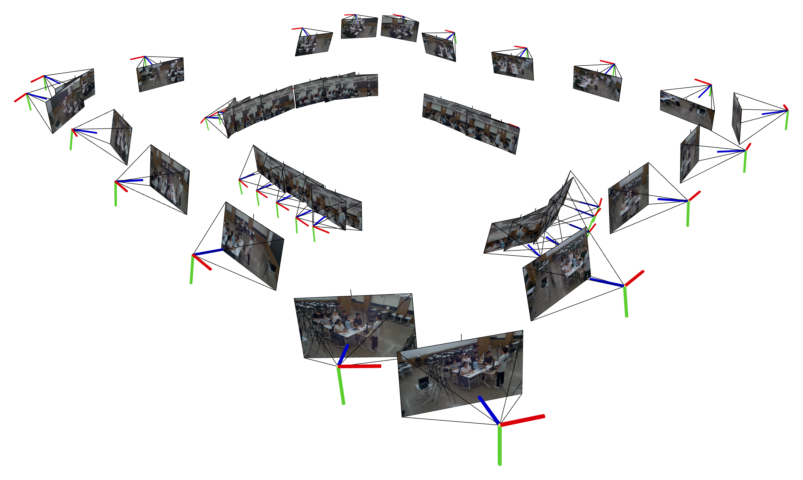
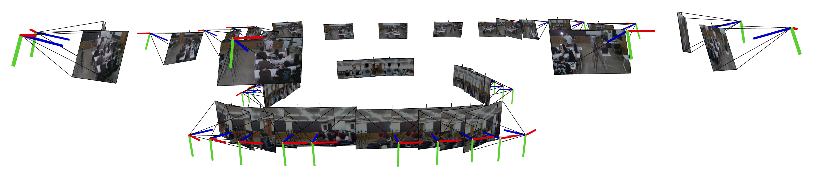
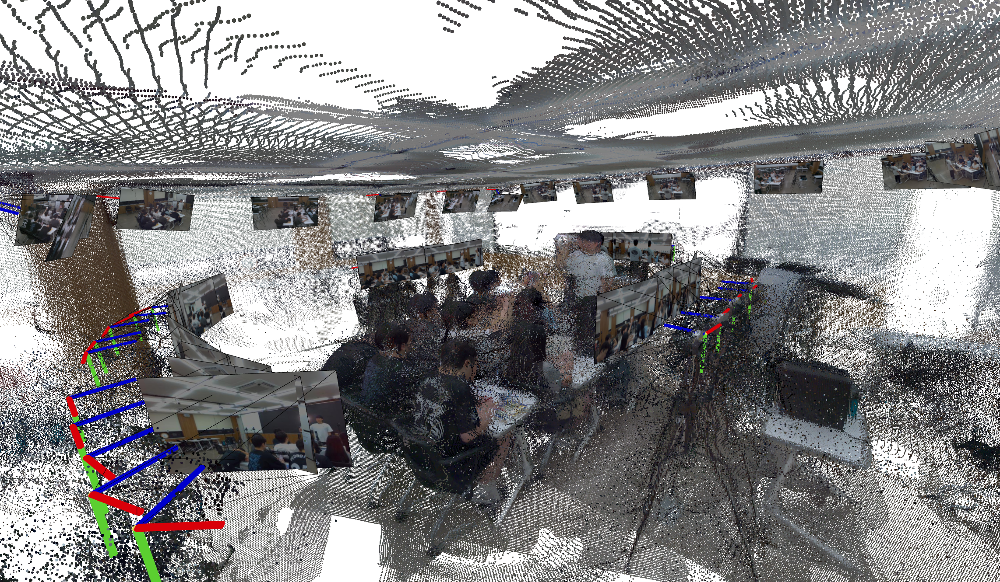
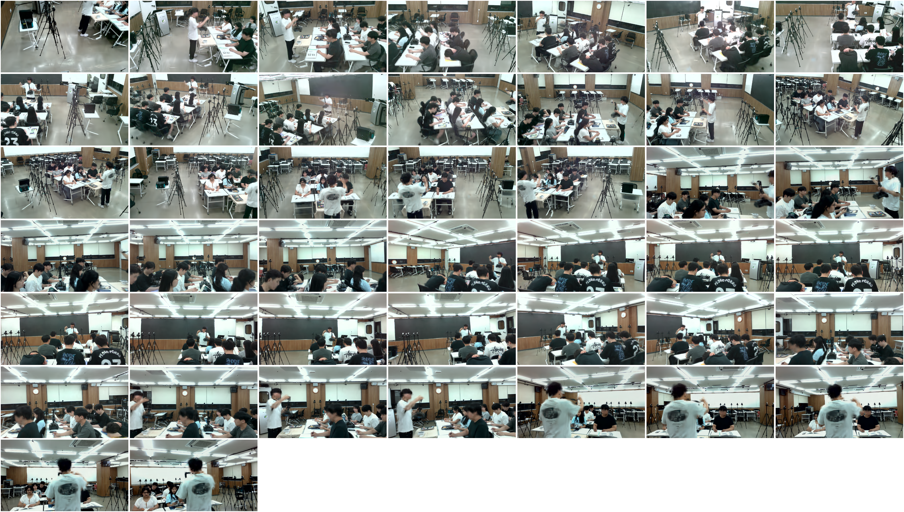
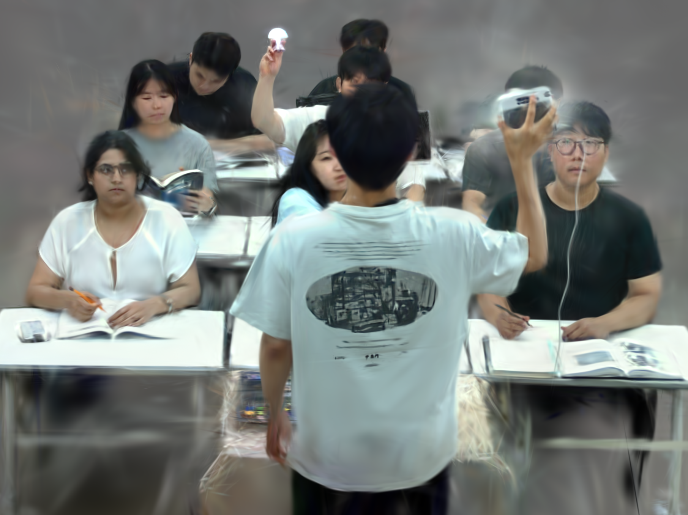

<div align="center">

# XR Classroom

### A Real-World Dynamic Multi-View Classroom Dataset Captured with Heterogeneous RGB Cameras for 3D/4D Gaussian Splatting

Soo-Been Jo<sup>1</sup> · Yeongil Ryu<sup>1</sup> · Isaac Yang<sup>1</sup> · Reagan Koo<sup>1</sup> · Seung Huk Ahn<sup>1</sup> · Ye-Eun Yeom<sup>1</sup> · Eun-Seok Ryu<sup>1</sup>

<sup>1</sup>Intelligent Multimedia Computing Laboratory (IMCLab), Department of Immersive Media Engineering, Sungkyunkwan University


</div>

<!--
TEASER — uncomment after adding the file.
Recommended: a short looping GIF/MP4 of a 4DGS free-viewpoint render (camera orbiting while the lecturer moves), ~800 px wide, < 10 MB.

<p align="center">
  
</p>
-->

---

## 📢 News

- **[2026.10]** Dataset documentation released. Data packages will be added in upcoming releases.
- **[2026.08]** XR Classroom was presented at the 2026 KACE Summer Conference (Korean Association of Computer Education).

---

## ✨ Highlights

- **Real-world lecture, not a studio** — an instructor and multiple learners moving at the same time in an actual classroom, with continuous mutual occlusions and a room-scale capture area.
- **Heterogeneous camera rig** — ceiling-mounted Basler industrial cameras and eye-level Intel RealSense cameras with different resolutions, fields of view, and color responses.
- **44 synchronized surrounding views** — all cameras face the center of the classroom and surround it from all sides at two different heights.
- **Original and compatible versions** — the original heterogeneous videos, plus a version with all views unified to 1920 × 1080 for existing training pipelines.
- **Built for 3D/4D Gaussian Splatting** — supports static 3DGS and dynamic 4DGS training, with a recommended held-out evaluation split for novel view synthesis.

---

## 🖼️ Visual Overview

### Capture Space
<p align="center"></p>
<p align="center"><em>The classroom used for capture, with Basler camera rigs fixed to the ceiling. Intel RealSense cameras were mounted on tripods at learners' eye level for each capture session (not shown).</em></p>

### Camera Layout
<p align="center"></p>
<p align="center"></p>
<p align="center"><em>Estimated camera poses of all 44 views. Top: oblique view of the cameras surrounding the classroom. Bottom: side view showing the ceiling-mounted and eye-level camera rows.</em></p>

### Capture Environment
<p align="center"></p>
<p align="center"><em>Reconstructed classroom point cloud with estimated camera poses.</em></p>

### Multi-View Samples
<p align="center"></p>
<p align="center"><em>The same synchronized frame of Scenario 2 from all 44 views. The first 19 views (row-major order) are ceiling-mounted Basler cameras; the remaining 25 are eye-level RealSense cameras.</em></p>

### Reconstruction
<p align="center"></p>
<p align="center"><em>3DGS free-viewpoint render of the lecture scene.</em></p>

---

## 🏫 Overview

**XR Classroom** is a multi-view dataset captured in a real classroom at Sungkyunkwan University. It provides synchronized dynamic sequences of two lecture scenarios, recorded simultaneously from 44 views of heterogeneous RGB cameras, for research on 3D/4D Gaussian Splatting, novel view synthesis, and volumetric video.

Widely used public multi-view datasets mostly capture a single object or a small space densely, and representative dynamic multi-view datasets use a single camera type in a forward-facing arrangement. XR Classroom instead surrounds a real lecture space from all sides with wide inter-view spacing and two camera types, while an instructor and multiple learners move at the same time.

The dataset contributes:
1. **Real classroom domain** — dynamic lecture scenes for 3D/4D Gaussian training and evaluation.
2. **Simultaneously captured multi-view video** — a basis for volumetric video compression and streaming research.
3. **Heterogeneous camera configuration** — unlike datasets with a unified camera type, resolution, and camera parameters, it supports research on pose estimation and reconstruction pipelines that are robust to heterogeneous conditions.

---

## 📷 Capture Setup

A total of 45 cameras were installed: 20 Basler and 25 RealSense. The dataset consists of **44 views**, excluding one Basler view (view 8) that had a capture error.

| | Basler | Intel RealSense |
|---|---|---|
| Model | acA2500-60uc | L515 |
| Installed cameras | 20 | 25 |
| Views in dataset | 19 (1 erroneous view excluded) | 25 |
| Mounting | Fixed to the ceiling (rigs of 5 per wall) | Tripods (learners' eye level) |
| Camera servers | 4 | 5 |
| Resolution (original version) | 1952 × 1088 | 1920 × 1080 |
| Resolution (compatible version) | 1920 × 1080 | 1920 × 1080 |
| Frame rate | Up to 30 fps | Up to 30 fps |

- **Modality:** RGB only. Depth streams of the RealSense cameras and audio are not included.
- **Camera arrangement:** All cameras face the center of the lecture space, and their positions and orientations are fixed during capture.
- **Acquisition:** The cameras are distributed across 9 camera servers (5 cameras each) and captured simultaneously.
- **Synchronization:** Cameras of the same type are synchronized by our in-house software. Across the two camera types, frames are aligned afterward using the moment the room lights are switched off as a common event.

---

## 🎬 Lecture Scenarios

| Scenario | Description | Length |
|---|---|---|
| Scenario 1 | The instructor explains using a physical teaching aid (a robot), and learners watch and study it. | ~20 s |
| Scenario 2 | During the lecture, some learners engage in off-task activities (e.g., reading comics, using a smartphone) that are hard to notice from the instructor's frontal viewpoint. | ~20 s |

Each sequence is aligned to the synchronized interval shared by all views. The scenes include diverse body motions — raising a hand to ask a question, taking notes, observing a teaching aid, talking to a learner sitting behind, and lowering the head — as well as:

- **Mutual occlusions** between the instructor and multiple learners
- **Two viewpoint heights and fields of view** from ceiling-mounted and eye-level cameras
- **View-dependent and high-frequency regions** such as reflections from indoor lighting, electronic screens, and detailed textures of teaching aids

---

## 📦 Dataset Availability

The dataset is released through the [IMCLab website](https://imclab.skku.edu/software). Download links will be added here when each package is ready.

| Item | Description |
|---|---|
| Multi-view video | RGB videos from 44 views (original / compatible versions, no audio) |
| Camera parameters | Per-view intrinsic and extrinsic parameters estimated with COLMAP / VGGT |
| Supported training | Static-frame 3DGS and dynamic-sequence 4DGS |
| Evaluation split | Recommended held-out views (see below) |

| Package | Scenario | Version | # Views | Size | Download |
|---|---|---|:---:|:---:|:---:|
| TBA | | | | | Coming soon |

For early access or collaboration, please contact [josubin@skku.edu](mailto:josubin@skku.edu).

### Original and Compatible Versions

- **Original version** — the core of the dataset. It keeps the differences in resolution and camera parameters between camera types.
- **Compatible version** — all views are unified to 1920 × 1080 for existing dynamic-scene pipelines that assume the same input resolution. The Basler 1952 × 1088 frames are center-cropped by 16 pixels on the left and right and 4 pixels on the top and bottom. Cropping is applied **before** camera parameter estimation, so the provided parameters refer to the compatible version.

### Recommended Evaluation Split

For quantitative evaluation of novel view synthesis, the center view of each Basler wall rig is held out:

- **Held-out views:** view 3, view 13, view 18
- **Training views:** all remaining views

The fourth center view (view 8) is excluded from the dataset because of a capture error. Under this protocol, the RGB frames of the held-out views must not be used for initial point generation, color correction, or model optimization; use them only to evaluate novel view synthesis after training.

<!-- TODO: add the view numbering diagram and the per-view camera-type list. -->

---

## 📄 Citation

If you use or refer to this dataset, please cite:

Soo-Been Jo, Yeongil Ryu, Isaac Yang, Reagan Koo, Seung Huk Ahn, Ye-Eun Yeom, Eun-Seok Ryu, "XR Classroom: A Multi-view Dataset for a 3D Neural Representation-Based Educational Platform," *Proceedings of the 58th KACE Summer Conference*, vol. 30, no. 2, Aug. 2026. (in Korean)

```bibtex
@inproceedings{jo2026xrclassroom,
  author    = {Soo-Been Jo and Yeongil Ryu and Isaac Yang and Reagan Koo and Seung Huk Ahn and Ye-Eun Yeom and Eun-Seok Ryu},
  title     = {{XR Classroom}: A Multi-view Dataset for a {3D} Neural Representation-Based Educational Platform},
  booktitle = {Proceedings of the 2026 Summer Conference of the Korean Association of Computer Education (KACE)},
  volume    = {30},
  number    = {2},
  year      = {2026},
  month     = aug,
  note      = {in Korean}
}
```

<!-- TODO: add pages once the proceedings are indexed (KoreaScience / DBpia). -->

The capture system and the free-viewpoint rendering pipeline are described in:

Soo-Been Jo, Yeongil Ryu, Isaac Yang, Reagan Koo, Eun-Seok Ryu, "Development of XR Educational Platform by Using 3D Neural Representation," *Proceedings of the 58th KACE Summer Conference*, vol. 30, no. 2, Aug. 2026. (in Korean)

---

## 📜 License

The dataset was captured with the consent of all participants. Dataset usage terms will be stated with the release package. Until then, please contact the maintainer before using or redistributing any data.

---

## 🙏 Acknowledgment

This work was supported by the National Research Foundation of Korea (NRF) grant funded by the Korea government (MSIT) in 2025 (No. RS-2024-00457605). This work was also supported by the Seoul Anchor Center, funded by the Ministry of Education and the Seoul Metropolitan Government in 2026, as part of the Regional Growth Talent Development System (ANCHOR) COSS (No. 2026-ANCHOR-01-113).

We thank our IMCLab members Yeong-Gyu Kim, Priyanka Muthukumaran, Uijoon Jeong, Yuchan Cho, Yeong Hun Jeong, and Inseo Jang for participating in the recorded lecture scenarios and for their help with the capture setup.

---

## 🔗 Contact & Related Links

- **Contact:** Soo-Been Jo ([josubin@skku.edu](mailto:josubin@skku.edu))
- **IMCLab, Sungkyunkwan University:** https://imclab.skku.edu/
- **Other IMCLab datasets:** VRrooms (IPIU 2025), [Library](https://github.com/reagan99/Library) (IEEE VR 2026 Workshops)
